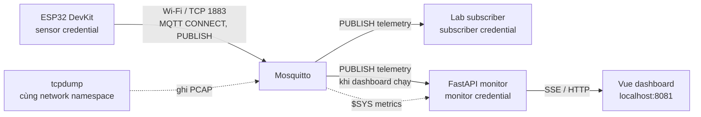

# MQTT LAB — luồng hoạt động end-to-end

Tài liệu này mô tả đường đi từ firmware ESP32 tới Mosquitto, subscriber, PCAP và dashboard; đồng thời giải thích cách đối chiếu các gói trong Wireshark. Lab hiện dùng MQTT 3.1.1 plaintext qua TCP port `1883`.

## 1. Sơ đồ thành phần



Container trong mạng `lab` dùng hostname `broker:1883`. Khi cần ESP32 kết nối từ LAN, `compose.firmware.yaml` thêm mạng `firmware_edge` và publish port 1883 vào đúng `BROKER_BIND_IP`. Dashboard được mở riêng qua proxy trên `127.0.0.1:8081` (hoặc `DASHBOARD_PORT`); không cần mở giao diện này ra LAN.

## 2. Khởi tạo và bật broker

1. `./run.sh` gọi `scripts/init_lab.py` để tạo/đồng bộ credential lab, sinh password file Mosquitto đã băm và ACL runtime.
2. `scripts/verify_lab.py` kiểm tra tài khoản hợp lệ, anonymous, password sai và hành vi publish ngoài quyền. Khi xác minh ACL deny, broker log là bằng chứng chính; MQTT 3.1.1 không phải lúc nào cũng thể hiện quyền ACL bị từ chối bằng một mã SUBACK rõ ràng.
3. Runner E00 dùng Compose project riêng, bật broker trên IP LAN lấy từ `.env.firmware`, rồi chạy probe client để kiểm tra broker sẵn sàng.
4. Mosquitto nạp `config/mosquitto/mosquitto.conf`, password file và ACL. Anonymous access bị tắt. Sensor chỉ có quyền ghi topic telemetry; subscriber được đọc telemetry; monitor được đọc `factory/#` và `$SYS/broker/#`.

Nếu chỉ chạy `docker compose up -d broker` với `compose.yaml`, mạng broker là internal và port không được publish ra máy chủ. Cấu hình firmware mới mở listener vào địa chỉ LAN cụ thể.

### Hai lệnh chạy thường dùng

- **Baseline E00:** điền `.env` và `.env.firmware`, tạo firmware header bằng `python3 scripts/generate_firmware_config.py`, nạp firmware lên ESP32, rồi chạy `./run.sh`. Lệnh này khởi tạo/kiểm tra lab và chạy capture E00; dashboard không nằm trong Compose project E00.
- **Dashboard + kết nối ESP32:** chạy `./run.sh dashboard --firmware`. Script khởi tạo auth/ACL, kiểm tra Compose, rồi recreate broker cùng dashboard/proxy để Mosquitto nạp cấu hình mới. ESP32 đang bật sẽ cần kết nối lại. Dashboard mở tại `http://localhost:8081` mặc định.

Trong cả hai chế độ, `MQTT_USERNAME`/`MQTT_PASSWORD` sinh vào firmware phải khớp với `SENSOR_USERNAME`/`SENSOR_PASSWORD` trong `.env`. Không commit `.env`, `.env.firmware` hoặc `firmware_config.h` đã sinh.

## 3. ESP32 kết nối và gửi telemetry

Firmware trong `firmware/mqtt_sensor/mqtt_sensor.ino` thực hiện các bước sau:

1. Kết nối Wi-Fi 2.4 GHz và nhận địa chỉ IP.
2. Mở TCP connection tới `MQTT_HOST:MQTT_PORT` (trong lab: máy broker, port `1883`). TCP thực hiện bắt tay SYN, SYN-ACK, ACK trước khi MQTT chạy.
3. Gửi MQTT `CONNECT` với `MQTT_CLIENT_ID`, username/password sensor và keepalive 30 giây. Broker trả `CONNACK`; nếu từ chối xác thực, firmware thử lại sau 2 giây.
4. Sau khi kết nối, firmware tạo telemetry mỗi `PUBLISH_INTERVAL_MS` (mặc định 1000 ms), với `device_id`, `message_id`, nhiệt độ, độ rung và uptime.
5. Gửi `PUBLISH` tới `factory/line-01/machine-01/telemetry`, QoS 1. Payload là JSON UTF-8. Firmware tăng `message_id` sau lần publish thành công theo logic hiện tại.

Vì port 1883 không mã hóa, người bắt được đúng luồng có thể đọc topic và payload; CONNECT cũng không được bảo vệ khỏi nghe lén. Chỉ dùng credential giả dành riêng cho lab.

## 4. MQTT QoS 1, TCP và các client nhận

QoS 1 có trao đổi xác nhận ở tầng MQTT:

```text
ESP32                         Mosquitto                       Subscriber / Dashboard
  |--- PUBLISH QoS 1 ------------>|                                      |
  |<-- PUBACK --------------------|                                      |
  |                               |--- PUBLISH telemetry ---------------->|
  |                               |<-- PUBACK (nếu nhận ở QoS 1) ---------|
```

Thứ tự chuyển tiếp tới subscriber và PUBACK trả về publisher có thể xen kẽ. Điểm cần phân biệt:

- **TCP ACK** xác nhận byte/segment của TCP đã được nhận. Thường có `Len=0`; bản thân nó không phải MQTT message và không mang payload MQTT.
- **MQTT PUBACK** là MQTT control packet xác nhận một PUBLISH QoS 1, có message identifier tương ứng.
- TCP có thể chia một MQTT packet thành nhiều segment. Wireshark sẽ ráp lại TCP stream và có thể hiện thêm một dòng MQTT đã giải mã.

Do đó, nếu chọn dòng `TCP ... [ACK]`, đang xem xác nhận TCP. Hãy tìm dòng Protocol `MQTT` với Info `Puback` để xem xác nhận QoS 1.

## 5. Subscriber và dashboard

Subscriber của baseline:

1. Kết nối bằng tài khoản subscriber và gửi `SUBSCRIBE` tới topic telemetry với QoS 1.
2. Broker trả `SUBACK`; sau đó chuyển tiếp các PUBLISH phù hợp.
3. `lab_clients/subscriber.py` ghi sự kiện connect, subscribed và message vào `subscriber.jsonl`, gồm timestamp UTC, message ID, topic và QoS.

Dashboard là client riêng, chỉ chạy khi profile `dashboard` bật. FastAPI sử dụng một MQTT client, subscribe `factory/#` và `$SYS/broker/#`, xử lý PUBLISH telemetry và thống kê broker. Backend cung cấp `/api/state` và `/api/events`; Vue nhận snapshot ban đầu và các cập nhật realtime qua SSE. Dashboard lưu tối đa 100 bản tin gần nhất và 120 điểm telemetry trong RAM; restart backend sẽ làm mất lịch sử RAM.

Mosquitto phát `$SYS/broker/#` định kỳ (cấu hình `sys_interval 5`). Dashboard dùng các metric này cho thống kê broker; bộ đếm thiết bị và PUBLISH IoT được tính từ các PUBLISH JSON trên `factory/#` có `device_id`. Kết nối dashboard cũng là một MQTT client và được tính trong tổng client của broker, nhưng không được tính như thiết bị IoT.

## 6. Capture E00 và artifact

`./run.sh` chạy `scripts/run_baseline.py`. Runner tạo `run_id` duy nhất, tạo thư mục artifact, build subscriber/capture, bật broker, kiểm tra kết nối, rồi chạy hai observer:

- **tcpdump** dùng `network_mode: service:broker`, tức cùng network namespace với broker, và ghi TCP port 1883 vào `baseline.pcap`.
- **subscriber** chờ MQTT telemetry và ghi event log.

Khi terminal báo `Capture ready`, bật hoặc reset ESP32. Runner chờ tối đa 120 giây để subscriber nhận đủ 60 bản tin. Cuối run, runner dừng capture/subscriber, lưu broker/capture/subscriber logs, `subscriber.jsonl`, `manifest.json`, kích thước PCAP và trạng thái run, rồi dọn Compose project riêng. `./run.sh` tiếp tục gọi `scripts/analyze_pcap.py`, tạo `packet-index.json` với frame đầu tiên và số lượng các loại MQTT control packet.

Artifact nằm tại `data/raw/<run_id>/`. PCAP và log là dữ liệu thô, bị loại khỏi Git; rà soát trước khi chia sẻ vì PCAP plaintext có thể chứa credential, topic và payload.

## 7. Đọc luồng trong Wireshark

### Bắt trực tiếp trên Windows

Khi ESP32 và broker giao tiếp qua LAN, chọn capture interface **Wi-Fi**. `vEthernet (WSL)` là giao diện ảo cho WSL và thường không phải vị trí để quan sát trực tiếp luồng ESP32 tới IP Wi-Fi của máy. Với baseline có thể tái lập, mở `baseline.pcap` do tcpdump trong namespace broker ghi bằng Wireshark.

Display filter thường dùng:

```wireshark
tcp.port == 1883
```

Hiện cả hai chiều. Các bộ lọc hẹp hơn:

```wireshark
tcp.dstport == 1883       # client -> broker
tcp.srcport == 1883       # broker -> client
mqtt                      # MQTT control packets đã được giải mã
mqtt.msgtype == 3         # PUBLISH
mqtt.msgtype == 4         # PUBACK
```

### Trình tự cần nhận ra

Trên một TCP connection mới, capture đủ sớm thường thấy TCP handshake, MQTT `CONNECT` → `CONNACK`, sau đó các client đọc gửi `SUBSCRIBE` → `SUBACK`. Khi ESP32 gửi telemetry sẽ thấy `PUBLISH` QoS 1 và phản hồi `PUBACK`; các client đã subscribe nhận bản sao PUBLISH. Khi đóng sạch, có thể thấy MQTT `DISCONNECT` trước khi TCP đóng.

Nếu bắt đầu capture sau khi connection đã thiết lập, CONNECT/CONNACK sẽ không có trong file. Wireshark có thể ghi chú `Unknown Version (missing the CONNECT packet?)` nhưng điều đó không tự chứng minh PUBLISH không hợp lệ; Wireshark chỉ thiếu gói mở đầu để biết phiên bản MQTT.

### Capture ESP32 đã quan sát

Trong capture Wi-Fi ngày 17/10/2026, luồng telemetry có source `192.168.100.127`, destination broker `192.168.100.102:1883`, topic `factory/line-01/machine-01/telemetry`, QoS 1 và payload JSON đọc được. Dòng `TCP ... [ACK] ... Len=0` xác nhận TCP; dùng `tcp.port == 1883` để thấy chiều broker → client và tìm MQTT PUBACK. Filter `tcp.dstport == 1883` ẩn các packet có source port 1883.

## 8. Giới hạn diễn giải và an toàn

- TCP ACK không chứng minh MQTT application đã xử lý hoặc lưu dữ liệu; MQTT PUBACK là xác nhận riêng của QoS 1.
- PUBLISH trong PCAP chứng minh gói đã đi qua điểm capture; đối chiếu subscriber JSONL và broker log để xác nhận client nhận hoặc broker xử lý.
- ACL deny cần đối chiếu broker log. Đừng kết luận quyền được cho phép chỉ từ SUBACK trong MQTT 3.1.1.
- Telemetry không đến không đồng nghĩa thiết bị offline: có thể capture sai interface, broker/firewall không tới được, hoặc subscriber chưa sẵn sàng.
- Chỉ thử trên broker, thiết bị và mạng thuộc lab; giữ port 1883 giới hạn trong LAN cần thiết, không bind ra `0.0.0.0`, không dùng mật khẩu thật.

## Biến thể TLS (cổng 8883)

Bản `firmware/mqtt_sensor_tls` gửi cùng telemetry tới broker qua TCP 8883 với TLS 1.2+; `tcpdump` ghi cả port 1883 và 8883. Trong Wireshark dùng `tcp.port == 8883`: thấy Client Hello/Server Hello và Application Data, nhưng topic/payload/CONNECT không đọc được. Xem [02 — Broker](setup/02-broker.md) và [03 — Firmware](setup/03-esp32-firmware.md).
